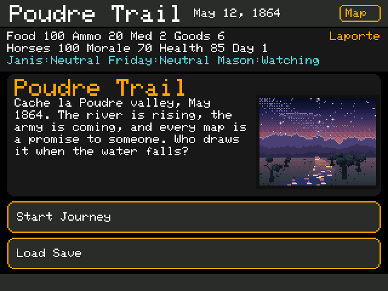
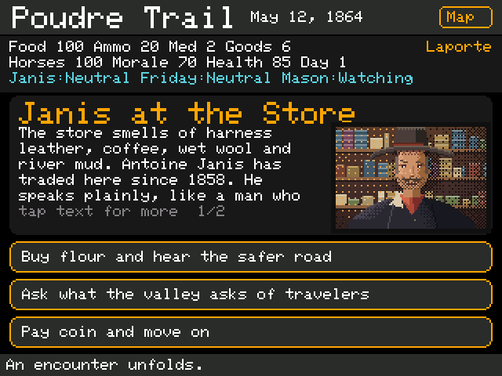
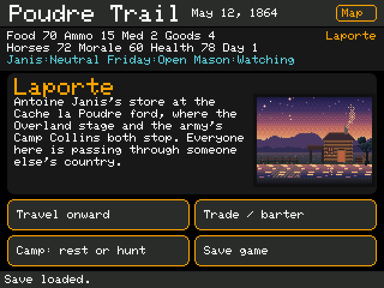
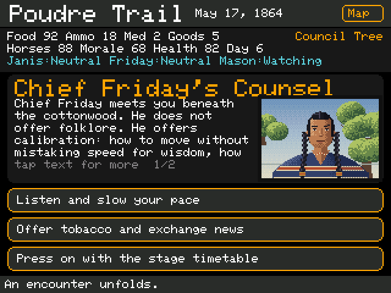
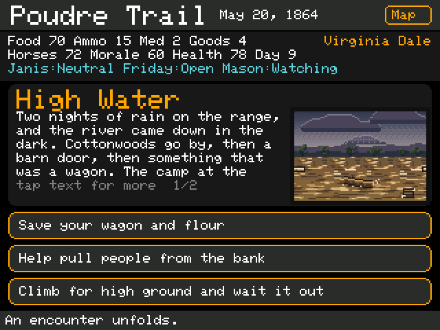
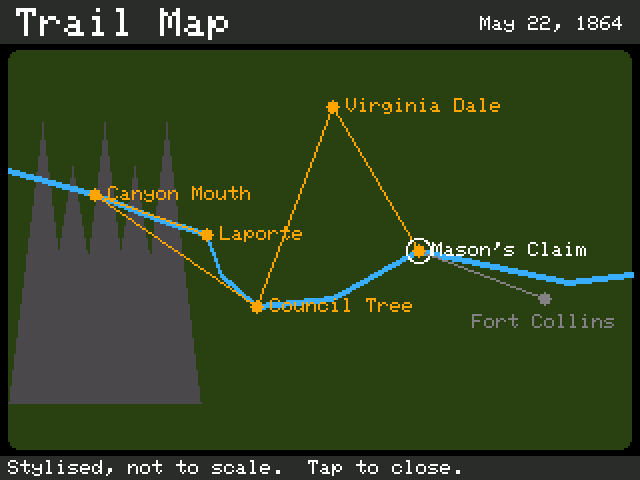
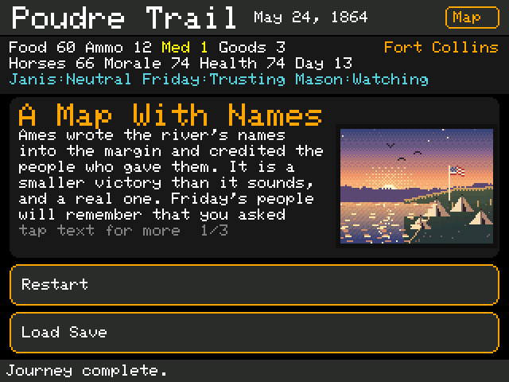
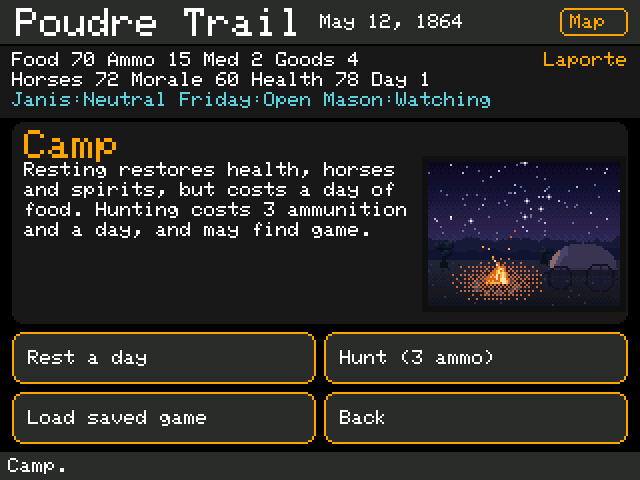

# Poudre Trail

An Oregon Trail-style travel game set in the Cache la Poudre valley of 1864, running on a $15 ESP32 "Cheap Yellow Display".

<table>
  <tr>
    <td></td>
    <td></td>
  </tr>
  <tr>
    <td></td>
    <td></td>
  </tr>
  <tr>
    <td></td>
    <td></td>
  </tr>
  <tr>
    <td></td>
    <td></td>
  </tr>
</table>

*These are renders, not photos: `tools/emulator` runs the firmware's own UI code on a PC against a software screen. See [Status / known issues](#status--known-issues).*

You lead a household down the Cache la Poudre in May 1864, from Laporte to the high ground that will become Fort Collins. Over six stops you trade, hunt, rest, and decide how to treat the people you meet: the trader Antoine Janis, Chief Friday and the Arapaho guide Little Willow, station keeper Virginia Slade, the land claimant Mason, and an army surveyor with a blank map. Food, horses, health and morale can end the trip; three separate reputations (Janis, Friday, Mason) and a handful of flags shape which ending you get. The question underneath is who gets to draw the map when the water falls. The whole story is compiled into the firmware, so it plays with no SD card; the card adds animated art and saves.


## What you need

- **An ESP32-2432S028R "Cheap Yellow Display"**, the 2.8" 320x240 touchscreen board. There are two panel variants; the build environment must match yours:
  - micro-USB board, ILI9341 panel: `esp32-2432S028R` (default)
  - USB-C board, ST7789 panel (colours inverted or picture shifted with the default): `esp32-2432S028R-st7789`
- **A USB cable that carries data** (many charge-only cables do not).
- **A microSD card** (optional). Needed for the art and for saving. The setup script's format step wipes the whole card.
- **A computer with Python 3 and PlatformIO**: `pip install platformio`. On Linux your user needs to be in the `dialout` group to flash.

A 3.5" ESP32-3248S035R environment (`esp32-3248S035R`) also exists in `platformio.ini`; see the known issues.

## Build and flash

```bash
pip install platformio

pio run -t upload                          # micro-USB / ILI9341 board
pio run -e esp32-2432S028R-st7789 -t upload  # USB-C / ST7789 board
pio device monitor                         # serial log at 115200 baud
```

If the upload hangs at "Connecting...", hold the board's BOOT button for a couple of seconds and try again.

On boot the serial log prints the panel (`[TFT] ... 320x240`), touch setup (`[TOUCH] init=ok ...`) and SD result (`[SD] OK ...` or `[SD] FAILED - built-in story, no art`).

To flash a CYD that is plugged into another machine (a Pi, a Libre Computer board, ...) over SSH:

```bash
tools/deploy_remote.sh user@host                                   # ILI9341 board
tools/deploy_remote.sh user@host --env esp32-2432S028R-st7789      # ST7789 board
```

It copies the project, installs PlatformIO there if needed, flashes, resets the board and prints its boot log.

## SD card prep

Use the helper script. **The format options erase the whole card** (it asks you to type `YES` first) and create a 16 GB FAT32 partition labelled `POUDRE` plus an exFAT `STORAGE` partition for the rest.

Windows, from an Administrator PowerShell in the repo root:

```powershell
Set-ExecutionPolicy -Scope Process -ExecutionPolicy Bypass
.\scripts\setup_and_flash.ps1
```

Linux / macOS: `sudo ./scripts/setup_and_flash.sh`

Both show the same menu, so each step can be run on its own:

| Option | Does |
|--------|------|
| 1 | Format the card, copy the game files, build and flash |
| 2 | Format the card only |
| 3 | Copy the game files to an already-formatted `POUDRE` card |
| 4 | Build and flash only |
| 5 | Format and copy, no flashing |

Doing it by hand instead: format a card FAT32, copy `data/art/` to `/art/` on the card, and copy `data/locations.csv`, `data/events.csv`, `data/trades.csv` and `data/events/` to `/data/`. The card's story files replace the built-in story only if they parse; a card carrying the old events format is ignored and the built-in story is used.

## Controls

Everything is touch.

- **Buttons**: tap an option. The title offers Start Journey and Load Save; at a stop the travel menu offers Travel onward, Trade / barter, Camp (rest or hunt) and Save game.
- **Continue**: after each choice a result screen shows what changed ("Food +10, Trade goods -1"); tap Continue.
- **Long text**: when text does not fit, the panel shows `tap text for more 1/2`; tap the text to turn the page.
- **Trade**: buy as often as you like (each purchase costs trade goods), then Leave trading post.
- **Camp**: Rest a day, Hunt (uses 3 ammo), Load saved game, or Back. Both Rest and Hunt cost a day of food.
- **Map**: tap the title bar (the amber Map chip) for a stylised trail map; tap anywhere to close.
- **Save / load**: Save game is in the travel menu and writes one slot, `/saves/slot1.sav`, on the SD card. Load Save is on the title, camp and end screens.

## Status / known issues

This is v1.0. A redesign with a contemporary interface and larger, animated art is planned as v2.

- **Partly verified on hardware.** On a micro-USB ESP32-2432S028R (ILI9341) the v1.0 build boots, mounts the SD card, initialises touch, and runs the built-in 1864 story (serial log: `[TFT] ... 320x240`, `[TOUCH] init=ok`, `[SD] OK`, `[GAME] route=6 stops`). The pin map, touch calibration, art colour order and button layout were checked on the same board with earlier builds. Not yet watched on the device with this build: a full tap-through (title, events, Continue, travel menu, Camp, Map, paged text), the GIF/PNG art, and save/load.
- **Old SD cards are ignored.** A card prepared for an earlier build (different CSV columns) is detected at boot and the built-in story is used instead; re-run the SD prep to get the art.
- **No real photo yet.** `docs/photo.jpg` does not exist, so the image above is a placeholder, and the screenshots are emulator renders. The emulator approximates TFT_eSPI (its real 5x7 font is used, shapes are approximate), and only draws the 2.8" layout.
- **Art needs the SD card.** Without one you get a "No art" placeholder and cannot save. GIF animation speed, memory use and colour order are untested on the device.
- **Touch calibration is per board.** The numbers are constants in `include/cyd_display.h`; there is no on-screen calibration screen. Taps landing offset or mirrored means editing them.
- **ST7789 and 3.5" builds are unverified.** Both compile; neither has been confirmed on a real board here.
- **One save slot, saved only from the travel menu**, not in the middle of an event.
- **Short game.** 21 events across 6 stops, each event at most once per run, so replays repeat. The Linux/macOS SD script has not been tested by us on real hardware.
- **History is compressed.** The story uses real places and people (Antoine Janis, Chief Friday, Virginia Slade) with compressed dates; Little Willow, Peter Ames and Mason are invented.
- **Not in this build:** ideas from the `dev` branch (tone-based dialogue variants, an on-screen touch calibration flow, design docs), and any sound.

## Development

```bash
make -C test run                      # 65 engine checks on the host, no hardware needed
tools/emulator/screenshots.sh         # re-render docs/screenshots from the real UI code (run `pio run` once first; needs Pillow)
python3 tools/embed_world.py          # after editing data/*.csv or data/events/*.txt
python3 tools/make_art.py             # regenerate data/art (needs Pillow)
```

The story is plain data: `data/locations.csv`, `data/events.csv`, `data/trades.csv` and `data/events/*.txt`. In `events.csv`, each event has `kind` (`story`, `trail` for random events between stops, or `timed:N` to fire once the day count reaches N), an optional `requiresFlag` expression (`a&!b&c|d` means a AND NOT b AND (c OR d)), and up to three choices with resource, reputation, flag and day changes. `embed_world.py` bakes them into `include/world_data.hpp` so the firmware has them without an SD card.

Hardware layout: LCD on HSPI (SCLK 14, MOSI 13, MISO 12, DC 2, CS 15, backlight 21), touch on its own pins (25, 32, 39, CS 33, read through LovyanGFX's XPT2046 driver), microSD on its own VSPI bus (18, 19, 23, CS 5). The pin map comes from the CYD-Diagnostic project.
